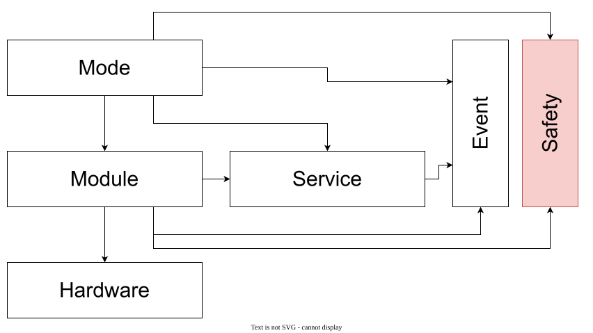

# codesys-framework
Framework to use with plc's in Codesys or TwinCAT

> Status: work in progress. This document describes the target architecture. Not everything is implemented this way yet.

## Libraries

| Library     | Contents |
|-------------|----------|
| **Utils**   | Generic building blocks with no knowledge of the framework: timestamp, timer, blink, ... |
| **Core**    | The framework itself: Mode, Module, Hardware, Component, Command, the services, and every interface the framework needs. |
| **IO**      | Simple IO: DI, DO, AI, AO. |
| **General** | General modules and services: EmergencyStop, AirPressure, UserRequest, SignalLamp, ... |
| **Motion**  | (planned) Axes and drives. |
| **Visu**    | Controllers and frames for the visualisation. |

### Dependencies

```
Application ──► Visu ──► General ──► Core ──► Utils
                         IO ──────► Core
                         Motion ──► Core
```

**Rule:** dependencies always point towards Core, never away from it. Core does not know General, IO or Motion.

**An interface lives in the lowest library that needs the concept.** If Core needs something from a higher library, Core defines the interface and the higher library implements it (dependency inversion). Examples:

| Interface        | Defined in | Implemented in          | Used by                  |
|------------------|------------|-------------------------|--------------------------|
| `I_SafetyModule` | Core       | General (EmergencyStop, light curtain, lidar, ...) | Core (`FB_SafetyService`) |
| `I_ModeRequest`  | Core       | Core (`FB_ModeService`) | General (`FB_UserRequestModule`) |
| `I_Module`       | Core       | every module            | Core (`FB_Mode`, `FB_ModuleGroup`) |

The **application** is the only place that knows every library. That is where the wiring happens: creating the instances and passing them to each other through `FB_Init`.

## Layers



An arrow means "uses". Mode and Module both report to **Event** and **Safety**, the two cross-cutting services that can stop modules (see [Services](#services)). Safety is used by the Mode (whole machine), by safety modules that report their state, and by intermediate modules that handle the safety of their own zone.

The source is [docs/layers/layers.drawio](docs/layers/layers.drawio). After editing it, re-export the SVG (the diagram is embedded, so the SVG can also be opened and edited in draw.io directly):

```
"C:\Program Files\draw.io\draw.io.exe" --export --format svg --embed-diagram --border 10 --output docs/layers/layers.svg docs/layers/layers.drawio
```

## Services

Two services can cause modules to stop. They **report**, but they never command modules themselves.

### EventService: regular modules

- Any module can raise an event with a level: info, warning, alarm, ...
- An alarm leads to a **Stop** (controlled stop).
- Alarms stay latched until they are reset. A reset only succeeds once the cause is gone (for example, low air pressure), so the machine cannot restart while the problem remains.
- Events carry their source (`nSubMachine`, `nSubMachineId`), so a parent can filter on its own subtree.
- How events are defined, registered and logged is described in [Events](#events).

### SafetyService: safety modules

- Safety modules (emergency stop, light curtains, lidars, ...) implement `I_SafetyModule`.
- The SafetyService aggregates them into a single state: `Ok`, `QuickStop` or `ResetRequired`.
- A NOK leads to a **QuickStop**.
- The **latch** lives in the SafetyService: after a NOK, the state stays `ResetRequired`, even once the cause is gone, until an explicit `Reset`. That reset only succeeds when every safety module is `Ok` again.
- A SafetyService is passed through `FB_Init`, not used as a global. That leaves room for several of them later, for example one per zone.

```iecst
// Core
INTERFACE I_SafetyModule
    PROPERTY Ok    : BOOL      // live state
    PROPERTY Name  : STRING
    METHOD   Reset : BOOL

INTERFACE I_SafetyService
    PROPERTY State : E_SafetyState   // Ok, QuickStop, ResetRequired
    METHOD   Reset : BOOL
```

> This is the **functional** reaction to safety: stopping cleanly, keeping the state machine consistent, and reporting. The actual safety function (STO, contactors) stays in the safety PLC or safety relay.

## Events

Events are **not defined centrally**. Every module or component defines its own events in its own event group. Core only provides the mechanism. This keeps the dependency rule intact: Core never needs to know about an event from General, IO or the application.

### Roles

| Block | Owns | Responsible for | Knows |
|---|---|---|---|
| `FB_Event` | its config, payload and state | edge detection, active/latched, reset rules, logging itself | `I_EventLogger` only |
| `FB_EventGroup` (one per module or component) | an array of `FB_Event` plus an enum | all event definitions of the module in one place, registering its events, a status for the group | `I_EventService` (only while registering) |
| `FB_EventService` (Core) | a list of `I_Event` references | the central register, the summary state, global reset, handing out the logger | `I_Event`, `I_EventLogger` |
| `FB_EventLogger` | a ring buffer | storing entries with a timestamp, writing them out asynchronously (Hyperion, file, visu) | nothing about events, only the data |

```
 FB_AirPressureModule ──uses──► I_EventGroup ──contains──► FB_Event[0..n]
                                     │                         │
                           RegisterEvents(srv)             Log(...)
                                     ▼                         ▼
                              I_EventService ───Bind───► I_EventLogger
```

### Interfaces

```iecst
I_Event         : Condition(x), Log(payload), Reset(), Bind(itfLogger),
                  Active, Registered, Config, Disable
I_EventGroup    : RegisterEvents(itfSrv), GetEvent(n) : I_Event, Count,
                  Active / WarningIsOn / AlarmIsOn     // status over its own events
I_EventService  : EXTENDS I_Service — Register(itfEvent), State : SC_EventState
I_EventLogger   : Log(scEvent, scPayload, eTransition)  // Raised, Cleared, Reset, OneShot
```

### An event group

Every module gets an enum and a group that derives from `FB_EventGroup`. All definitions of the module are in `Initialize`, one line per event.

```iecst
{attribute 'qualified_only'}
{attribute 'strict'}
TYPE E_AirPressureEvent :
(
    PressureNok := 0,
    PressureLow,
    SensorFault,
    Count               // always last
);
END_TYPE

FUNCTION_BLOCK FB_AirPressureEvents EXTENDS FB_EventGroup
VAR
    _afbEvents : ARRAY[0..E_AirPressureEvent.Count] OF FB_Event;
END_VAR

METHOD Initialize
Configure(E_AirPressureEvent.PressureNok, cEv_MainPressureNotOk,   E_EventLevels.EventIsAlarm_SupervisorLevel, TRUE, 'Invalid air pressure');
Configure(E_AirPressureEvent.PressureLow, cEv_MainPressureLow,     E_EventLevels.EventIsWarning_Urgent,        TRUE, 'Air pressure low: %0 bar');
Configure(E_AirPressureEvent.SensorFault, cEv_PressureSensorFault, E_EventLevels.EventIsAlarm_OperatorLevel,   TRUE, 'Pressure sensor fault');
```

`Configure` lives in the base and fills in `nSubMachine` and `nSubMachineId` from the group, so every instance of a module can have its own source.

### Flow

1. **Declaration (`FB_Init`).** Only store references. Never call methods on other FBs here.
2. **Initialize (first cycle).**
   1. The module calls `_itfEvents.RegisterEvents(_itfEventSrv)`.
   2. The group runs its `Initialize` (the `Configure` lines).
   3. The group calls `itfEventSrv.Register(GetEvent(e))` for each of its events.
   4. The service stores the reference and calls `itfEvent.Bind(_itfLogger)`. `Bind` sets `Registered := TRUE`, so the duplicate check costs nothing.
3. **Every cycle.**
   - The module calls `Condition(x)` for condition alarms. A rising edge makes the event active and logs `Raised`, a falling edge logs `Cleared`.
   - The module calls `Log(payload)` for one-shots, such as a mode request. That writes one log entry and keeps no state.
   - The event calls `_itfLogger.Log(...)`, which only adds an entry to the buffer.
   - The service loops over its list and builds the summary state (`SC_EventState`, optionally per submachine). `FB_Mode` uses it to go to Stop or Invalid.
   - The logger writes its buffer to the real destination.
4. **Reset.** The service calls `Reset()` on every event. The event decides for itself: it only resets when `xResetable` is set and the condition is gone, and then logs `Reset`.

### Wiring

```iecst
fbLogger            : FB_EventLogger;
fbEventSrv          : FB_EventService(itfLogger := fbLogger);
fbAirEvents         : FB_AirPressureEvents(nSubMachine := 1, nSubMachineId := 0);
fbAirModule         : FB_AirPressureModule(itfEventSrv := fbEventSrv,
                                           itfEvents   := fbAirEvents, ...);
```

```iecst
// FB_AirPressureModule.Initialize
_itfEvents.RegisterEvents(_itfEventSrv);

// FB_AirPressureModule, every cycle
_itfEvents.GetEvent(E_AirPressureEvent.PressureNok).Condition(NOT _itfHw.AirPressureOk);
```

Injecting the group lets the application replace it (other messages, levels or translations per machine) without changing the library. A module may also own a default group and only use the injected one when it is set (`IF itfEvents <> 0`).

### Rules

1. **An event does not know the service**, only the logger. A group only knows the service while registering.
2. **Nothing happens in `FB_Init`** except storing references. Registering happens in `Initialize()`.
3. **An unregistered event must not crash** (`_itfLogger <> 0`). It can be detected, to find events that were never registered.
4. **The logger is a buffer**, not a direct write. Logging costs almost nothing in the module's cycle, and ten events in the same cycle are not lost. The logger keeps an overflow counter.
5. **Event IDs are unique constants per library**, with their own range per library, for example `16#100..` for Core and `16#1000..` for General. Instances are told apart by `nSubMachine` and `nSubMachineId`, never by a different ID.
6. **`cMaxEvents` must be generous.** When the list is full, the service logs it, so no event disappears silently.

## Mode tree

Modes and modules form a **tree**, with the Mode as the root. A module with children behaves towards those children the way the Mode behaves towards its modules.

```
FB_AutoMode                     ← reads SafetySrv + EventSrv (whole machine)
 ├─ FB_FeedStation             ← reads SafetySrv zone "Feed" (lidar)
 │   ├─ FB_Conveyor
 │   └─ FB_Gripper
 └─ FB_PressStation
     ├─ FB_Press
     └─ FB_Clamp
```

### Rules

1. **One parent.** Every module has exactly one parent. Only that parent issues commands such as `Execute`, `Enable` or `Home`.
2. **Stop is dominant.** `Stop()` and `QuickStop()` only travel down the tree, never sideways. A module in (Quick)Stop rejects other commands until it receives a `Reset`. Stopping always wins.
3. **Commands go down, status goes up.** A parent only reports "stopped" once all of its children are `NOT Busy`.
4. **Read services only within your own scope.** The root (Mode) reacts to everything. An intermediate module only reads a service when it has to handle something locally, such as the safety of its zone or alarms from its subtree. Otherwise the services stay 0 in `FB_Init`.
5. **Modules do not stop each other through events.** A module raises an event, and its parent decides what happens.
6. **Leaf modules do not know about services.** They execute `Stop()` or `QuickStop()` when their parent asks, and at most raise an event themselves. That keeps them reusable.

### Reaction in the Mode

| Trigger                    | Mode state  | Action on children | Then |
|----------------------------|-------------|--------------------|------|
| SafetyService ≠ `Ok`       | `QuickStop` | `QuickStop()`      | once all children have stopped: `Invalid`, wait for ResetSafety |
| Alarm via EventService     | `Stop`      | `Stop()`           | once all children have stopped: `Standby` or `Invalid` |
| StopRequest from user      | `Stop`      | `Stop()`           | `Standby` |

- A command is **repeated every cycle** while the state is active, not only on entering it. This follows the semantics of `FB_Command`: calling `Invoke` repeatedly means polling.
- The base implementation stops all children **in parallel**. A concrete mode or module may override `ProcessStop` when the order matters (first the conveyor, then the robot).

### `FB_ModuleGroup`

`FB_Mode` and `FB_Module` each have their own state machine. The logic for stopping children therefore lives in a helper FB in Core that both use (composition, not inheritance):

```iecst
FUNCTION_BLOCK FB_ModuleGroup
VAR
    _aChildren : ARRAY[0..cMaxChildren] OF I_Module;
END_VAR

METHOD Stop      : BOOL   // Stop() on all children, TRUE = all stopped
METHOD QuickStop : BOOL
METHOD Reset     : BOOL
PROPERTY Busy    : BOOL   // OR of all children
```

```iecst
// in ProcessQuickStop of a Mode or module
IF _fbChildren.QuickStop() THEN
    _eState := ...;   // next state
END_IF
```

## User requests

Start, stop, reset, ... are **commands to Core**. They do not go through the EventService: an event means "this happened", a request means "do this" and needs feedback.

```
Visu / push buttons / remote
        │
        ▼
FB_UserRequestModule (General) ──► I_ModeRequest (Core) ──► FB_ModeService ──► active FB_Mode
```

### Core: `I_ModeRequest`

Core defines which requests exist. The Mode's state machine decides whether a request is allowed in the current state.

```iecst
INTERFACE I_ModeRequest
    METHOD StartRequest         : BOOL   // TRUE = accepted
    METHOD StopRequest          : BOOL
    METHOD QuickStopRequest     : BOOL
    METHOD ResetSequenceRequest : BOOL
    METHOD ResetSafetyRequest   : BOOL
    METHOD SetRequest           : BOOL   // iRequest, pData, pSize: mode-specific

INTERFACE I_ModeService EXTENDS I_ModeRequest
    METHOD   RequestMode
    PROPERTY ActiveMode
    PROPERTY ActiveState
```

- A rejected request is logged through the EventService.
- `SetRequest` is a generic channel. The concrete request IDs are defined in the application or in the concrete Mode. Core only routes them to the active mode.

### General: `FB_UserRequestModule`

This is where everything about **where** a request comes from and **how** it arrives lives:

- **Sources:** visu, hardware push buttons, remote/OPC UA.
- **Arbitration:** local/remote, which source is allowed to operate the machine.
- **Gestures:** pressing stop twice within 500 ms becomes a QuickStop, holding stop becomes a ResetSequence.
- **Logging** with `sSource`.
- **Routing:** `ResetSafety` goes to both the SafetyService and the Mode.

The visu controllers only know `I_UserRequestModule` and contain no logic of their own.

## Wiring in the application

```iecst
fbEventSrv      : FB_EventService(...);
fbSafetySrv     : FB_SafetyService(aSafetyModules := [fbEmergencyStop, fbLightCurtain]);

fbAutoMode      : FB_AutoMode(
                      eMode       := E_Modes.Auto,
                      fbEventSrv  := fbEventSrv,
                      fbSafetySrv := fbSafetySrv,
                      aModules    := [fbFeedStation, fbPressStation]);

fbModeSrv       : FB_ModeService(fbEventSrv := fbEventSrv, afbModes := [...]);
fbUserRequest   : FB_UserRequestModule(fbModeRequest := fbModeSrv, fbSafetySrv := fbSafetySrv);
```

### Order in the task

1. Read hardware / IO
2. SafetyService
3. ModeService / Mode
4. Modules (parent before child)
5. Write hardware / IO

Another order also works, but then the reaction comes one cycle later.
